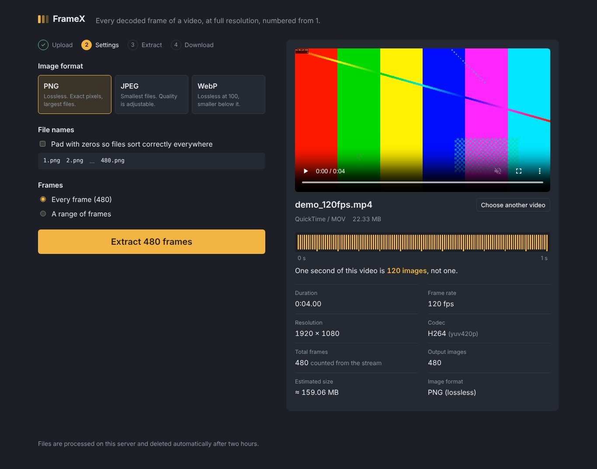
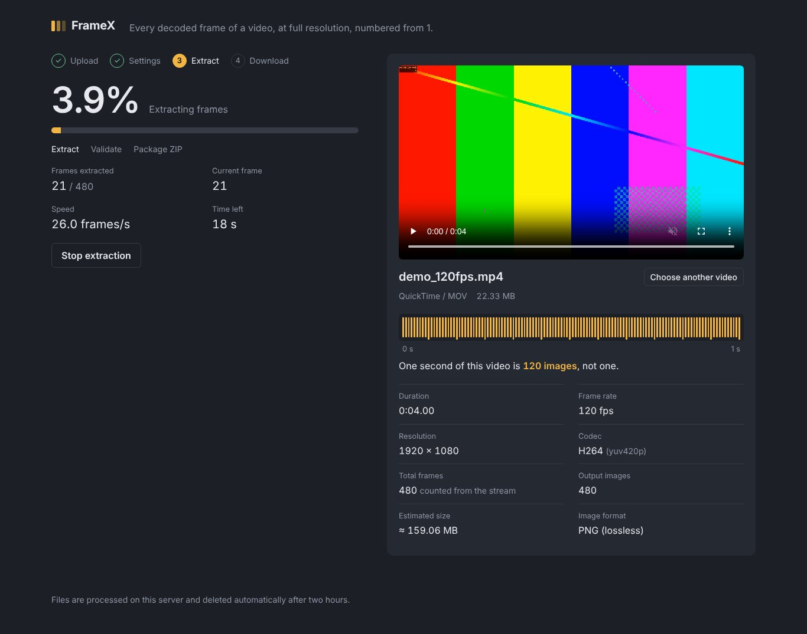
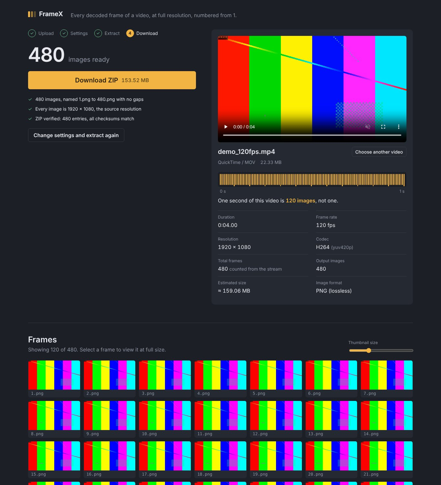

# FrameX – Video Frame Extractor

Upload a video and get **every decoded frame** as an image, at the original resolution, named `1.png … N.png`, packaged in a verified ZIP.

A 10-second clip at 30 fps gives 300 images. At 120 fps, 1,200. Not one image per second — every frame.



| Extraction in progress | Result and frame gallery |
|---|---|
|  |  |

## Download

Get the apps from the [Releases page](https://github.com/myselflittle-collab/-V2Ifps/releases/latest):

| Platform | File | How to install |
|---|---|---|
| **Windows 10/11 (64-bit)** | `FrameX-Setup-x.y.z.exe` | Run it. No administrator rights needed. FFmpeg is included. If SmartScreen says "Windows protected your PC", click **More info → Run anyway** (the installer isn't code-signed). |
| Windows, no install | `FrameX-Portable-x.y.z-win64.zip` | Unzip anywhere and run `FrameX.exe`. |
| **Android 10+** | `FrameX-x.y.z.apk` | Open it on the phone and allow installing from your browser or Files app when asked. |

The Windows app is the full FrameX (FFmpeg engine) in its own window. The Android app is a native app that decodes with the phone's own video decoder, works offline, and saves the ZIP to **Download/FrameX**. Both produce `1.png … N.png` at the original resolution in a verified, stored (not recompressed) ZIP.

## Features

- **Exact frames, exact count.** FFmpeg decodes the video and writes each frame once, in presentation order (`-fps_mode passthrough`). No `fps=` filter, no frame duplication or dropping.
- **Variable frame rate (VFR) support.** Phone videos with variable timing are counted frame by frame. The real decoded count is reported, not `duration × fps`.
- **Original resolution.** No scaling, cropping or enhancement. Rotation metadata is applied so portrait videos come out upright.
- **PNG (default, lossless), JPEG (quality 1–100, default 100) or WebP** (lossless at 100). High-bit-depth sources produce 16-bit PNGs.
- **Sequential naming** from `1`, never `0`, no gaps, no reset per second. Optional zero padding (`0001.png`).
- **Frame range** selection (frame-exact, by decoded frame index).
- **Video info panel:** filename, duration, FPS, resolution, codec, total frames, output image count, estimated output size (measured by encoding sample frames), selected format.
- **Live progress:** percentage, frames extracted, current frame, speed, time left. Extraction can be stopped.
- **Validation before download:** 1..N filenames with no gaps, every image readable and the source size, decoded count compared with the stream index, ZIP entry list and CRC-32 of every entry. The ZIP is written as `.part` and only becomes downloadable after it passes. Progress never reads 100 % unless everything succeeded.
- **Frame preview gallery** with infinite scroll, adjustable thumbnail size and a full-size viewer (← / → to step frame by frame, save a single frame).
- **Low memory use.** Frames stream from FFmpeg to disk; the ZIP streams files from disk one at a time and stores them without recompression (`ZIP_STORED`), so the bytes in the ZIP are exactly the extracted images.
- **Automatic cleanup** of uploads, frames and ZIPs after 2 hours of inactivity (configurable).

## Requirements

- Python 3.10+
- Node.js 18+ (only to build the frontend)
- FFmpeg 5.1+ (with `ffprobe`) on your `PATH`
  - Windows: `winget install Gyan.FFmpeg`
  - macOS: `brew install ffmpeg`
  - Ubuntu/Debian: `sudo apt install ffmpeg`
  - Android (Termux): `pkg install ffmpeg python nodejs`

## Quick start

```bash
git clone https://github.com/myselflittle-collab/-V2Ifps.git
cd ./-V2Ifps
pip install -r backend/requirements.txt
./run.sh          # Windows: run.bat
```

Open http://localhost:8000. `run.sh` builds the frontend on first run and serves it from FastAPI.

## Building the apps

Both apps are built and tested automatically by GitHub Actions (`.github/workflows/release.yml`). Pushing a tag such as `v1.0.1` builds everything and publishes a release:

```bash
git tag v1.0.1
git push origin v1.0.1
```

What the pipeline checks before publishing:

- **Windows:** builds `FrameX.exe` with PyInstaller (bundling FFmpeg and the UI), runs its `--selftest` (generates a 10 s 30 fps clip, extracts it, expects exactly 300 PNGs at 1280×720 named 1..300 and a CRC-valid ZIP), builds the installer, installs it silently and runs the self-test again on the installed app.
- **Android:** runs the ZIP unit tests (including a 70,000-entry ZIP64 archive), then on an Android emulator extracts FFmpeg-generated test videos (30 fps, 120 fps, variable frame rate, rotated) and checks every single frame against a marker that moves 5 px per source frame, so a skipped, duplicated or shifted frame fails the build. It also compares pixels with FFmpeg's own decode, then installs and launches the release APK.

### Build locally

**Windows .exe** (on Windows, from the repo root):

```powershell
cd frontend; npm ci; npm run build; cd ..
pip install -r backend/requirements.txt -r desktop/requirements.txt
# put ffmpeg.exe, ffprobe.exe and their DLLs (a "shared" FFmpeg build) in desktop\ffmpeg_bin\
pyinstaller desktop/framex.spec --noconfirm        # → dist\FrameX\FrameX.exe
& "${env:ProgramFiles(x86)}\Inno Setup 6\ISCC.exe" desktop\installer.iss   # → dist_installer\FrameX-Setup-1.0.0.exe
```

`FrameX.exe --browser` opens the UI in your default browser instead of an app window. App data and logs live in `%LOCALAPPDATA%\FrameX`.

**Android APK:** open the `android` folder in Android Studio and choose **Build → Build APK(s)**, or with Gradle 8.11+ and JDK 17: `gradle -p android assembleRelease`. Without signing variables the APK is signed with the debug key, which is fine for your own phone; Android then asks you to uninstall the old version before installing one built on a different machine. To sign with your own key, set `FRAMEX_KEYSTORE`, `FRAMEX_KEYSTORE_PASSWORD`, `FRAMEX_KEY_ALIAS` and `FRAMEX_KEY_PASSWORD`.

## Development

Run the API and the Vite dev server in two terminals:

```bash
# terminal 1 – API on :8000 (auto-reload)
cd backend
pip install -r requirements-dev.txt
python -m uvicorn app.main:app --reload --port 8000

# terminal 2 – UI on :5173 (proxies /api to :8000)
cd frontend
npm install
npm run dev
```

Run the tests (generates its own test videos with FFmpeg):

```bash
cd backend
python -m pytest -v
```

## Tests

| Test | Video | Checked |
|---|---|---|
| A | 10 s, 30 fps, 1920×1080 | exactly 300 images, `1.png`…`300.png` |
| B | 10 s, 60 fps, 1280×720 | exactly 600 images |
| C | 10 s, 120 fps | exactly 1,200 images |
| D | Variable frame rate | count equals FFprobe's real decoded count, which differs from duration × fps |
| E | 3840×2160 (4K) | every image is 3840×2160 |
| F | 3 minutes, 25 fps (4,500 frames) | JPEG, zero-padded names `0001.jpg`…`4500.jpg` |
| Extra | 23.976 fps, VP9 WebM → WebP, 90° rotation metadata, frame ranges, bit-exact PNG vs. raw decode, gallery, bad input | |

Every test also verifies the ZIP: entries in order, stored without recompression, CRC check, and image sizes.

## How it works

```
Browser ── PUT /api/upload (streamed to disk) ──► FFprobe: metadata + packet count
        ── POST /api/jobs/{id}/estimate ───────► encode 3 sample frames, measure size
        ── POST /api/jobs/{id}/extract ────────► background thread:
                                                   1. ffmpeg -map 0:v:0 -fps_mode passthrough
                                                      -start_number 1 -progress pipe:1 → %09d.png
                                                   2. rename to 1..N (or zero-padded)
                                                   3. validate names, sizes, readability
                                                   4. ZIP_STORED → .part → CRC check → rename
        ◄─ GET /api/jobs/{id} (polled for progress)
        ── GET /api/jobs/{id}/frames | thumbs/{name} | frames/{name}   (gallery)
        ── GET /api/jobs/{id}/download ────────► FrameX_Extracted_Frames.zip
```

### API

| Method | Path | Purpose |
|---|---|---|
| GET | `/api/health` | FFmpeg version check |
| PUT | `/api/upload?filename=…` | Upload raw video bytes as the body; returns the job with metadata |
| GET | `/api/jobs/{id}` | Job status, progress, metadata, results |
| POST | `/api/jobs/{id}/estimate` | Estimated image count and output size for given settings |
| POST | `/api/jobs/{id}/extract` | Start extraction: `{format, quality, zero_pad, start_frame, end_frame}` |
| POST | `/api/jobs/{id}/cancel` | Stop a running extraction |
| GET | `/api/jobs/{id}/frames?offset=&limit=` | List extracted file names |
| GET | `/api/jobs/{id}/frames/{name}` | Full-resolution frame |
| GET | `/api/jobs/{id}/thumbs/{name}` | 320 px JPEG thumbnail (generated on demand, cached) |
| GET | `/api/jobs/{id}/download` | The validated ZIP |
| DELETE | `/api/jobs/{id}` | Delete the job and all its files |

### Configuration (environment variables)

| Variable | Default | Meaning |
|---|---|---|
| `FRAMEX_WORK_DIR` | `backend/workspace` | Temporary storage for uploads, frames and ZIPs |
| `FRAMEX_JOB_TTL` | `7200` | Seconds of inactivity before a job's files are deleted |
| `FRAMEX_MAX_UPLOAD` | 20 GB | Upload size limit in bytes (`0` = no limit) |
| `FRAMEX_DISK_FACTOR` | `2.2` | Free disk required as a multiple of the estimated output (frames + ZIP) |
| `FRAMEX_FFMPEG` / `FRAMEX_FFPROBE` | from `PATH` | Paths to the FFmpeg binaries |

## Notes on accuracy

- **Frame count before extraction** comes from `ffprobe -count_packets` (one packet decodes to one frame for practically every codec). The count after extraction is the true decoded count and is the one the ZIP contains. If the two ever differ, FrameX tells you.
- **Output size:** PNG frames are large. A 1080p frame is typically 0.3–3 MB, so a minute of 60 fps 1080p video can produce several GB. The estimate is shown before you start, and disk space is checked before extraction begins.
- **Speed** depends on resolution and CPU. PNG encoding is the slowest step; JPEG is several times faster.

## Project structure

```
desktop/           Windows app: launcher (native window + self-test), PyInstaller spec, installer
android/           Android app (Kotlin, Jetpack Compose)
  app/src/main/…/engine/   VideoProbe (metadata, frame count, VFR), FrameDecoder (MediaCodec →
                           OpenGL → RGBA), FrameExtractor (parallel PNG/JPEG/WebP encoding,
                           naming, validation), ZipStore (stored ZIP/ZIP64 writer + verifier)
  app/src/androidTest/     Emulator tests with FFmpeg-made videos and reference frames
backend/
  app/
    main.py        FastAPI routes, job orchestration, static frontend
    probe.py       FFprobe metadata, frame count, VFR and rotation detection
    extractor.py   FFmpeg command, progress parsing, naming, validation, thumbnails
    zipper.py      Streaming ZIP_STORED archive with integrity check
    jobs.py        Job state, progress maths, automatic cleanup
    config.py      Environment configuration
  tests/           End-to-end API tests (A–F and more)
frontend/
  src/
    App.tsx        Flow: upload → settings → extract → download
    api.ts         Typed API client
    components/    UploadZone, VideoSheet (with frame ruler), SettingsPanel,
                   ProgressPanel, ResultPanel, Gallery (with full-size viewer)
```

## License

MIT. The Windows build bundles FFmpeg (GPL build from [BtbN/FFmpeg-Builds](https://github.com/BtbN/FFmpeg-Builds)); its licence is included next to `FrameX.exe`.
